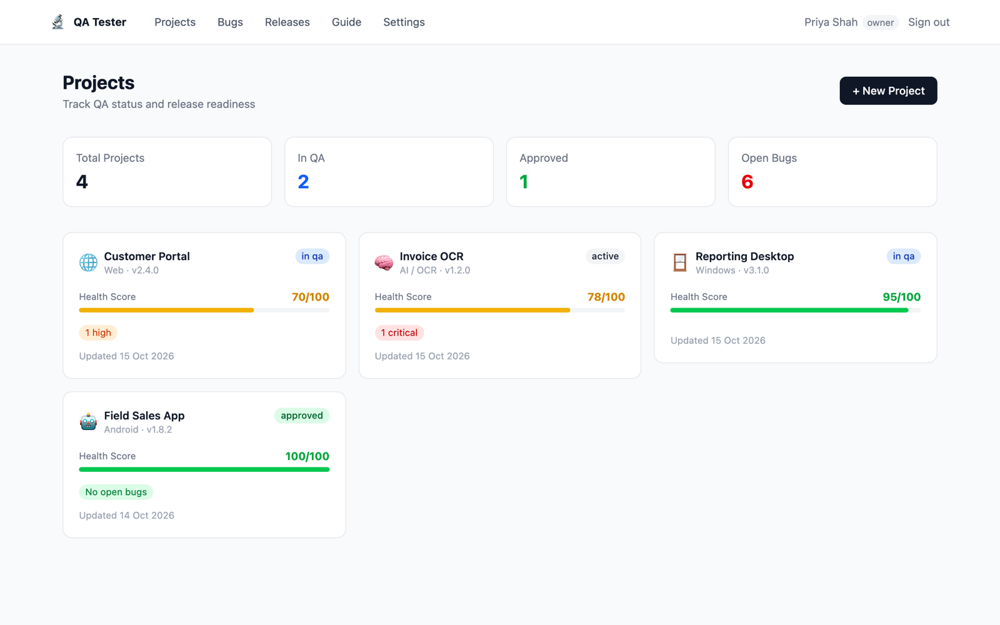
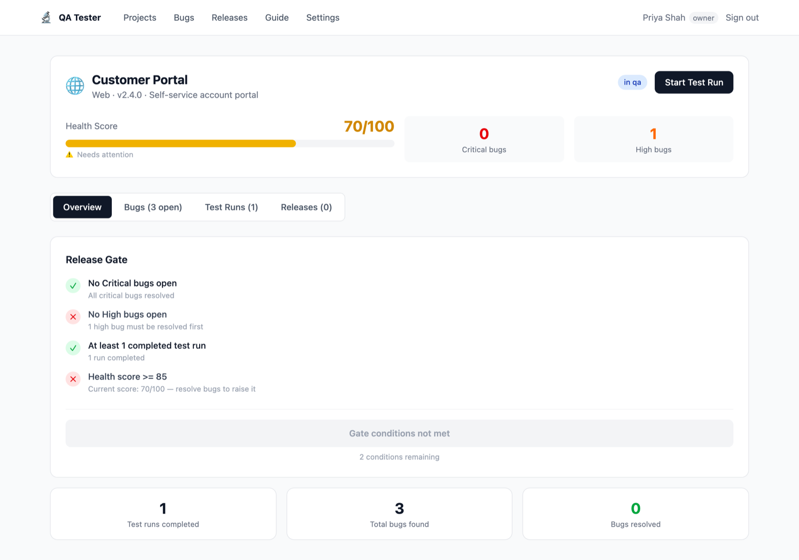
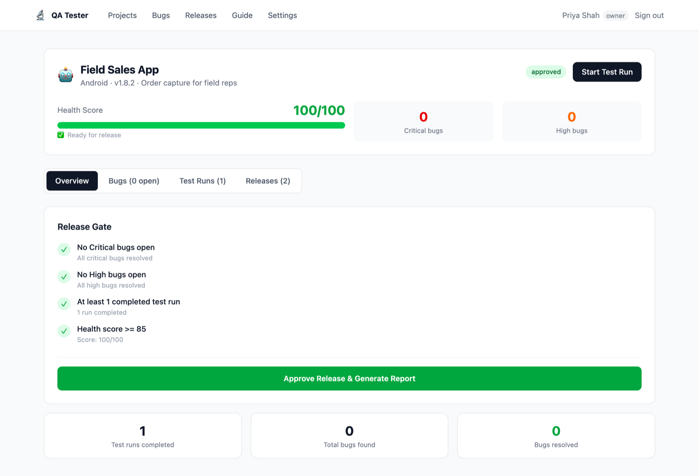
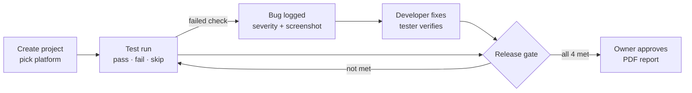
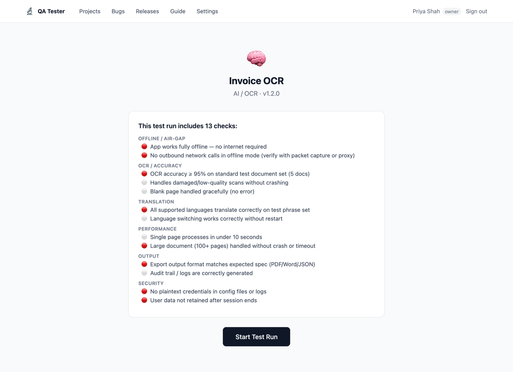
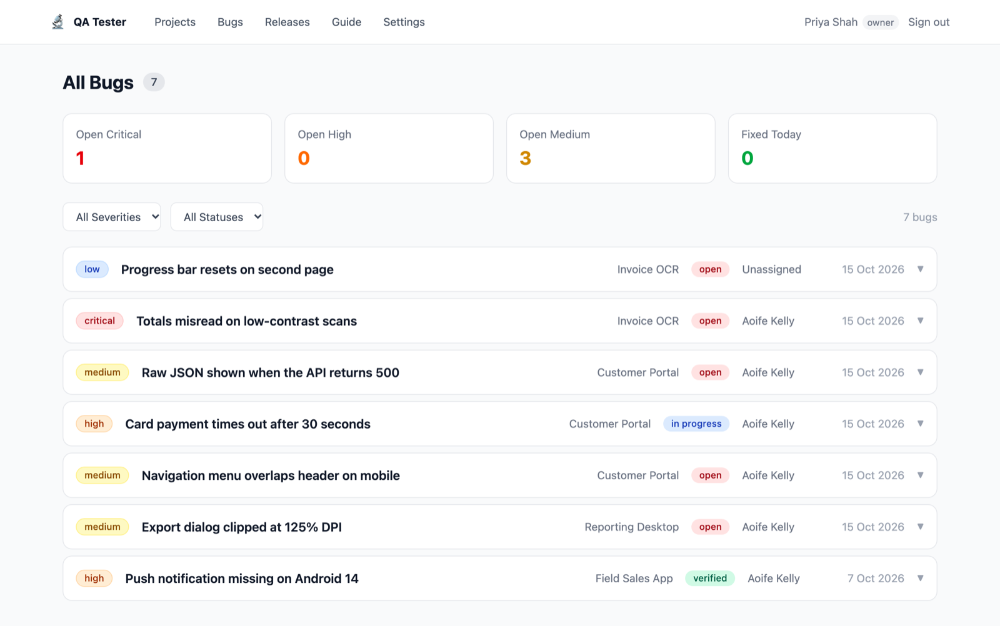

# QA Tester: Release Gate System

A QA workflow app for small development teams that ship across web, desktop, mobile and AI. Testers work through a platform-specific checklist, failed checks become tracked bugs, and a release can only be approved once the project passes a set of quality gates.

I built it for a small team that was shipping client software with no consistent testing process. Releases went out on "looks fine to me", and bugs reached the client. This tool makes "ready to ship" a measurable decision instead of a judgement call.

> **Source code is private.** It runs on our team's private server. This repo shows how it works. The screenshots use made-up demo data. Happy to walk through the code on request.

---

## The release gate

A project can only be approved when all four conditions are met:

| Condition | Why |
|---|---|
| No open **Critical** bugs | Nothing that breaks core functionality ships |
| No open **High** bugs | Major issues are fixed, not deferred |
| At least one **completed** test run | Every release has been tested end to end |
| Health score **≥ 85** | The overall quality bar is met, not just the top-severity issues |

| Blocked: 2 conditions remaining | Passed: ready to approve |
|---|---|
|  |  |

### Health score

Each project starts at 100 and loses points for every open bug:

| Severity | Penalty |
|---|---|
| Critical | −20 |
| High | −10 |
| Medium | −5 |
| Low | −2 |

The score updates live as bugs are logged and resolved. Approving a release generates a PDF report for sign-off with the health score, check totals, bug counts by severity and the gate results.

## How it works

**Checklists.** Each platform has its own template: 72 checks in total, 41 of them marked critical.

| Platform | Checks | Covers |
|---|---|---|
| Web | 19 | Functionality, payments, responsive layout, security, cross-browser |
| Windows | 13 | Install/uninstall, offline mode, stability, DPI scaling |
| Android | 13 | Device compatibility, permissions, notifications, Play Store |
| iOS | 14 | Device compatibility, permissions, App Store, privacy manifest |
| AI / OCR | 13 | Air-gapped operation, OCR accuracy, translation, performance, audit logs |

**Bug tracking.** Bugs are logged from failed checks and linked to their test run, with severity, repro steps and a screenshot. They move through open → in progress → fixed → verified, or get deferred.

**Roles.** Owner, Tester and Developer. Only the Owner can approve a release or manage users.

## Stack

| Layer | Technology |
|---|---|
| App | Next.js 16 (App Router), React 19, TypeScript |
| UI | Tailwind CSS v4, Radix UI |
| Data | PostgreSQL |
| File storage | MinIO (S3-compatible), for screenshots and PDF reports |
| Auth | NextAuth v5, credentials with role-based access |
| Reports | jsPDF |
| Hosting | Self-hosted on Ubuntu with PM2 and Nginx |

---

[Portfolio](https://sanjayprakash-git.github.io/portfolio/) · [LinkedIn](https://linkedin.com/in/sanjay-prakash-a92291186)
